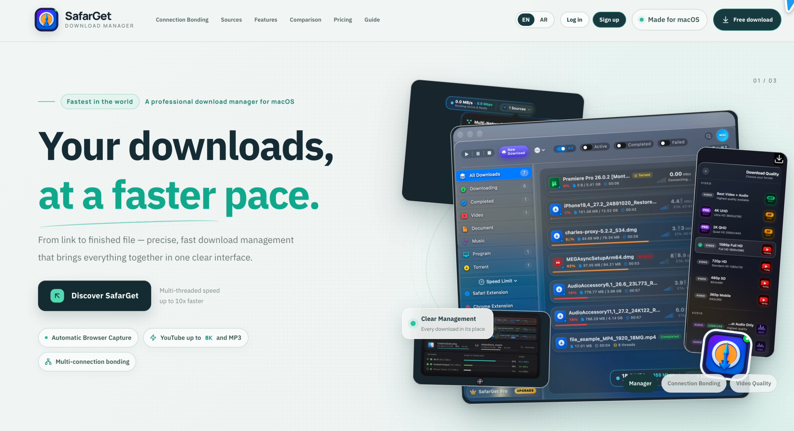
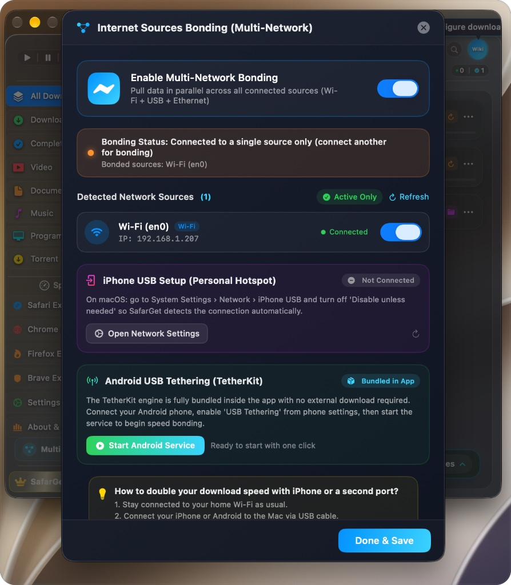
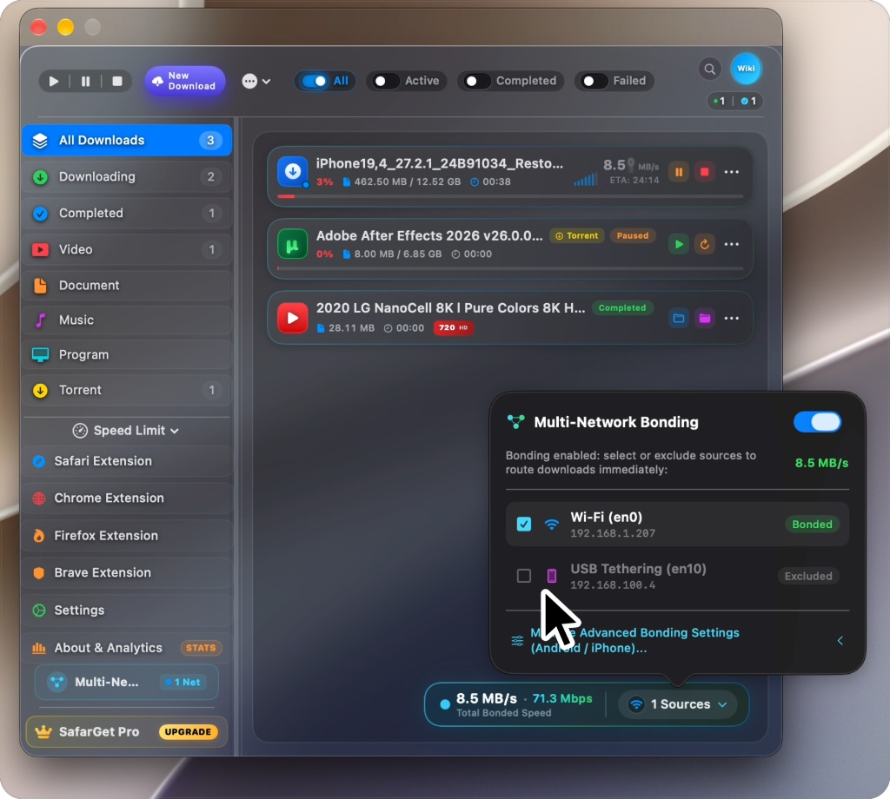
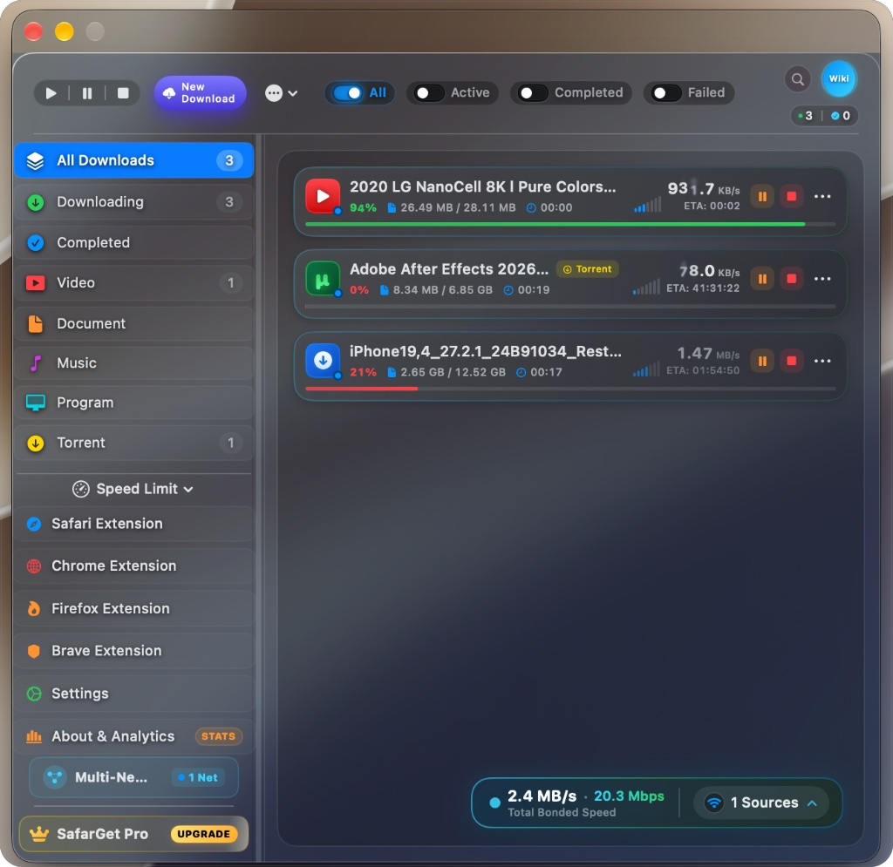
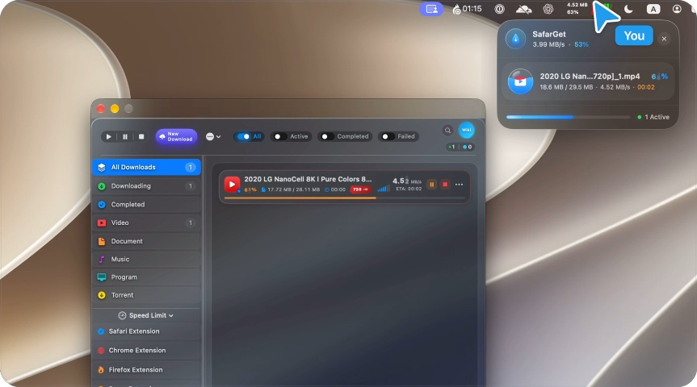
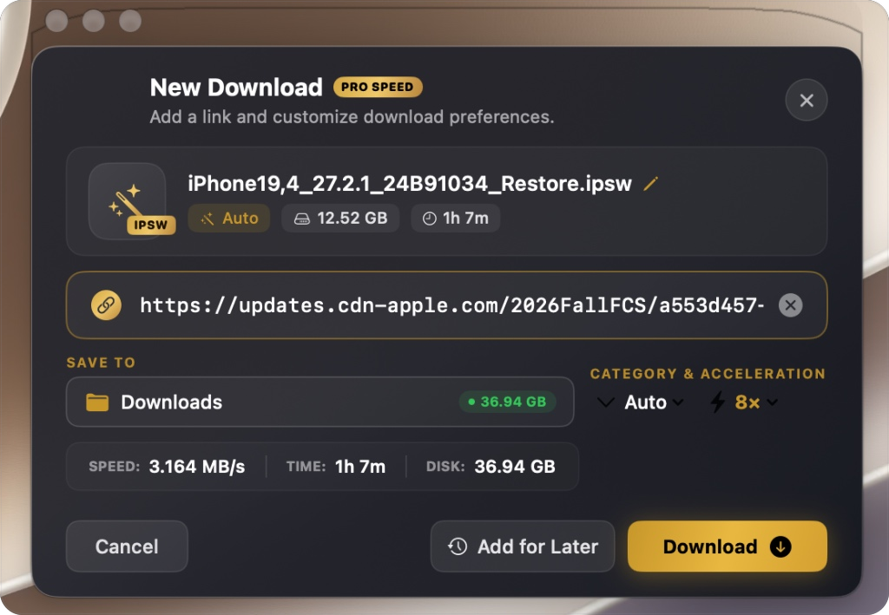
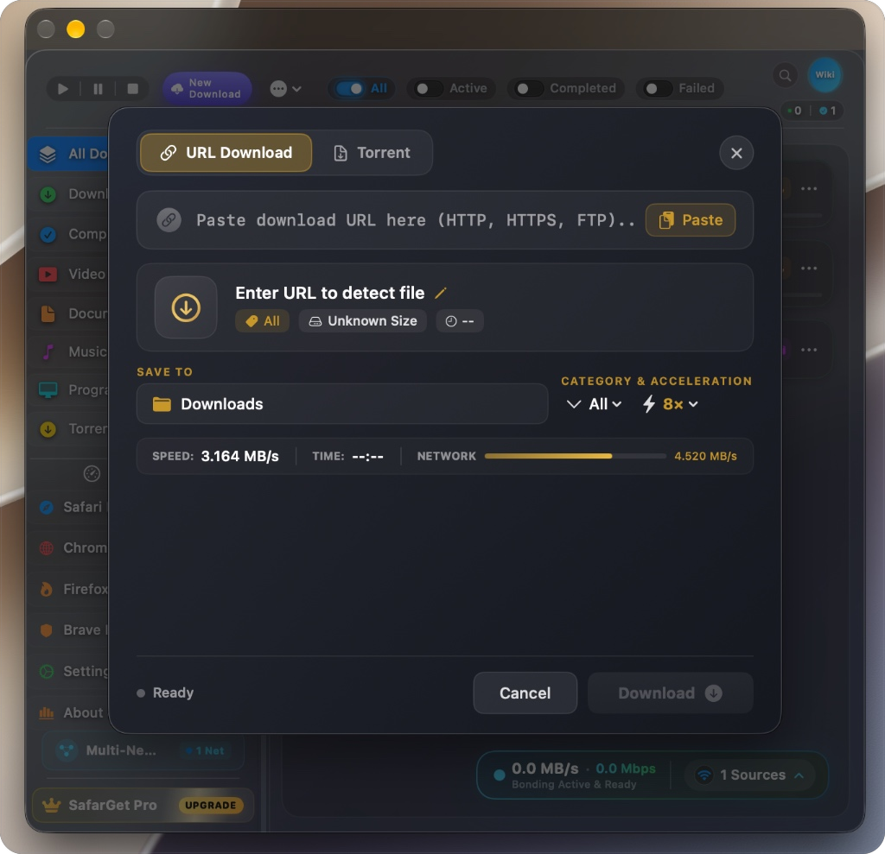
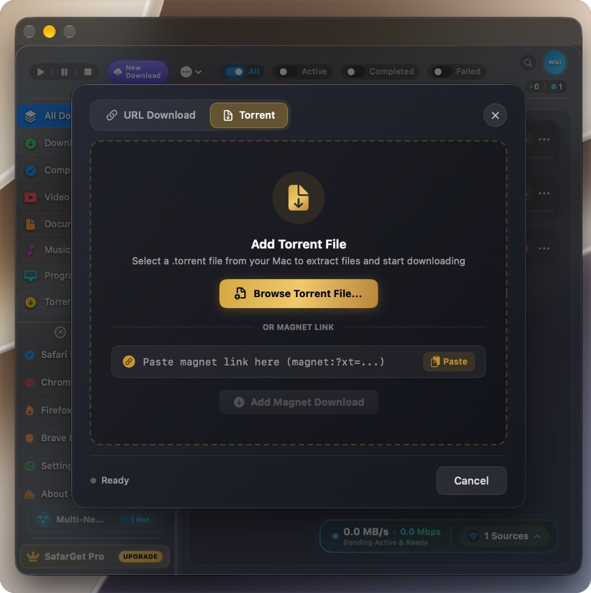
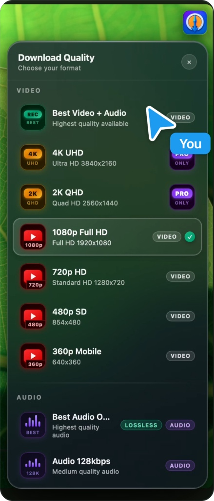
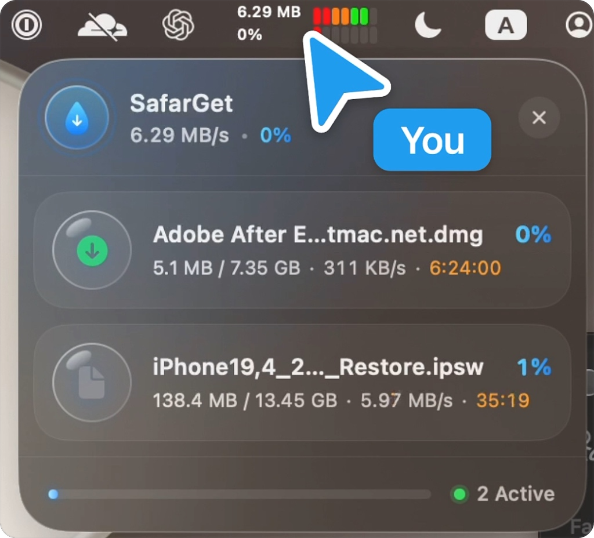

<h1>SafarGet for macOS</h1>

<strong>Your downloads, at a faster pace.</strong> 
A native, ultra-fast download manager built from the ground up for macOS &amp; Apple Silicon — featuring <strong>Multi-Network Bonding</strong>, <strong>Automatic 4-Browser Interception</strong>, <strong>YouTube up to 8K &amp; Lossless Audio</strong>, and a <strong>Built-in BitTorrent Client</strong>.

  
  
  
  

  
  
  
  
  

 

---

## Why SafarGet?

Most download managers on macOS are either heavy cross-platform ports or outdated utilities that lack real browser integration. **[SafarGet](https://safarget.com/)** brings a true native, IDM-class download architecture to macOS — combining **multi-threaded speed acceleration**, **real-time multi-network bonding**, **automatic browser capture across 4 major browsers**, **8K video extraction**, and a **native BitTorrent client** inside one clean, modern macOS interface.

| Feature | What It Does |
| :--- | :--- |
| **Multi-Network Bonding** | Combines **Wi-Fi**, **Ethernet**, **iPhone USB (5G Hotspot)**, and **Android USB Tethering (bundled TetherKit)** in parallel to maximize total download speed — with live source toggling mid-download. |
| **Automatic Browser Capture** | Seamlessly intercepts downloads from **Safari**, **Chrome**, **Firefox**, and **Brave** the moment you click a link — no manual copy-pasting required. |
| **Up to 10× Multi-Threaded Engine** | Dynamically splits files into **8, 16, or 32 parallel segments** to saturate your available bandwidth, with pause/resume support and real-time disk space checks. |
| **YouTube up to 8K & Lossless Audio** | Downloads video in **8K UHD**, **4K UHD**, **2K QHD**, **1080p Full HD**, and lower resolutions, or extracts **Lossless / MP3 Audio** directly. |
| **Built-in Native BitTorrent Client** | Handles `.torrent` files and **Magnet Links** (`magnet:?xt=...`) with interactive file-tree selection, pause/resume, and seeding — no separate torrent app needed. |
| **Menu Bar Live Telemetry** | Monitor active speeds (`MB/s`), progress percentages, and ETAs directly from the macOS menu bar or frosted-glass floating mini-bar. |
| **1,000+ Supported Sources** | Native support for **YouTube**, **MEGA**, **Google Drive**, **GitHub**, **SourceForge**, **MediaFire**, **Dropbox**, **1fichier**, **Qiwi.gg**, **Torrent**, and 1,000+ HTTP/HTTPS/FTP sites. |
| **Built for Apple Silicon** | Native performance on **M1, M2, M3, M4** and **Intel** Macs, signed with **Apple Developer ID**, with 100% local processing and zero external tracking. |

---

## Flagship Feature: Multi-Network Bonding

Why rely on a single internet connection when you have more bandwidth sitting on your desk? **SafarGet Multi-Network Bonding** distributes download segments across all active network interfaces simultaneously:

- **Parallel Multi-Source Pulling**: Combine home **Wi-Fi (`en0`)**, **Ethernet**, **iPhone USB Personal Hotspot**, and **Android USB Tethering** into one unified speed pipe.
- **Bundled Android TetherKit Engine**: Built directly into SafarGet with **one-click activation** — no external drivers or third-party downloads required.
- **Guided iPhone USB Setup**: Automatic detection with a direct shortcut to macOS Network Settings.
- **Live Source Switching**: Enable or exclude any network interface *while a download is running* without losing a single byte of progress.

<table>
  <tr>
    <td align="center" width="50%">
      
       
      <b>Internet Sources Bonding Panel</b> — Wi-Fi, iPhone USB &amp; bundled Android TetherKit
    </td>
    <td align="center" width="50%">
      
       
      <b>Live Source Switching</b> — Route or exclude networks in real time with Total Bonded Speed telemetry
    </td>
  </tr>
</table>

---

## Visual Tour

### Unified Command Center & Desktop Experience

Organize every download automatically into **Video**, **Document**, **Music**, **Program**, and **Torrent**, filter instantly by **All / Active / Completed / Failed**, and cap bandwidth on the fly (**Unlimited**, **10 MB/s**, **5 MB/s**, **1 MB/s**) via the sidebar **Speed Limit** control.

<table>
  <tr>
    <td align="center" width="52%">
      
       
      <b>Main Dashboard</b> — Concurrent YouTube, Torrent &amp; direct file downloads with Total Bonded Speed
    </td>
    <td align="center" width="48%">
      
       
      <b>Native macOS Integration</b> — Clean main window paired with the live Menu Bar speed popover
    </td>
  </tr>
</table>

### Pro Speed Dialog, Direct URLs & Native BitTorrent

Every intercepted or manually added download gives you full pre-flight control: auto-detected file size, live estimated completion time, free disk space indicator, thread acceleration selector (**8× / 16× / 32×**), and **Add for Later** scheduling.

<table>
  <tr>
    <td align="center" width="34%">
      
       
      <b>New Download (Pro Speed)</b> — Auto-detected metadata, disk check &amp; 8× acceleration
    </td>
    <td align="center" width="33%">
      
       
      <b>Direct URL Injection</b> — HTTP, HTTPS &amp; FTP with live network speed gauge
    </td>
    <td align="center" width="33%">
      
       
      <b>Integrated BitTorrent</b> — Browse <code>.torrent</code> files or paste Magnet links
    </td>
  </tr>
</table>

### Media Quality Picker & Menu Bar Telemetry

Pick the exact video or audio quality before downloading, and monitor live speeds without keeping the main window open.

<table>
  <tr>
    <td align="center" width="34%">
      
       
      <b>Media Quality Selector</b> — Best Video + Audio, 4K/2K/1080p &amp; Lossless Audio
    </td>
    <td align="center" width="66%">
      
       
      <b>Menu Bar Live Speed Widget</b> — Real-time bandwidth bars, percentage progress &amp; active queue at a glance
    </td>
  </tr>
</table>

---

## Supported Browsers & Platforms

### Official Browser Extensions

SafarGet connects directly to your browser via local `localhost` messaging for instant link capture and video detection:

| Browser | Automatic Link Interception | Video Quality Menu | MEGA Interception | Status |
| :--- | :---: | :---: | :---: | :---: |
| **Safari** | Yes | Yes | Yes | Bundled in App |
| **Google Chrome** | Yes | Yes | Yes | Official Extension |
| **Firefox** | Yes | Yes | Yes | [Mozilla Add-ons](https://addons.mozilla.org/en-US/firefox/addon/safarget-pro-download-manager/) |
| **Brave** | Yes | Yes | Yes | Official Extension |

### Supported Download Sources (1,000+ Sites)

`YouTube` · `MEGA` · `Google Drive` · `GitHub` · `SourceForge` · `MediaFire` · `Dropbox` · `1fichier` · `Qiwi.gg` · `BitTorrent / Magnet` · `HTTP / HTTPS / FTP` · `+ 1,000 additional websites`

---

## How SafarGet Compares

| Capability | **SafarGet (macOS)** | Legacy Mac Managers | Standard Browsers |
| :--- | :---: | :---: | :---: |
| **Native Apple Silicon (M1–M4) & Intel** | Native & Optimized | Often Ported / Emulated | Standard |
| **Multi-Network Bonding (Wi-Fi + USB + Ethernet)** | **Built-in + Live Switch** | Not Available | Not Available |
| **Automatic Capture (Safari, Chrome, Firefox, Brave)** | **All 4 Browsers** | Limited / Manual | Basic |
| **YouTube Video up to 8K & Lossless / MP3 Audio** | **Built-in** | Partial / Unstable | None |
| **Official MEGA Support** | **Built-in** | Limited | Browser Only |
| **Integrated BitTorrent & Magnet Client** | **Built-in** | Rarely Included | None |
| **Dynamic Multi-Threaded Splitting** | **Up to 32 Threads (10×)** | Limited | Single Stream |
| **Menu Bar Live Speed Widget & Mini-Bar** | **Native macOS UI** | Basic / None | None |

---

## Getting Started

1. **Download SafarGet**: Grab the latest macOS installer from the [Official Website](https://safarget.com/) or [GitHub Releases](https://github.com/BASHEER-A/SafarGet/releases).
2. **Allow System Notifications**: On first launch, click **Allow** when macOS prompts for notifications so you receive real-time completion alerts and extension status updates.
3. **Enable Your Browser Extension**:
   - **Safari**: Open `Safari Settings → Extensions`, check **SafarGet**, and click **Always Allow on Every Website…** so automatic interception works seamlessly.
   - **Chrome / Brave / Firefox**: Install the official **SafarGet Pro** extension (see [Firefox Add-on](https://addons.mozilla.org/en-US/firefox/addon/safarget-pro-download-manager/) or the sidebar links inside the app), grant permissions, and pin it to your toolbar.
4. **Optional — Enable Multi-Network Bonding**:
   - Connect your **iPhone** via USB (turn off *Disable unless needed* under `System Settings → Network → iPhone USB`) or connect your **Android** phone with USB Tethering enabled and click **Start Android Service** (TetherKit is pre-bundled).
   - Toggle **Multi-Network Bonding** ON and watch your combined download speed scale up immediately.

> For full step-by-step walkthroughs, visit the [Complete SafarGet User Manual (Wiki)](https://safarget.com/wiki/).

---

## Plans & Privacy

### Simple, Transparent Pricing

- **Free Tier**: Fast native macOS downloads, core browser integration, smart categorization, and torrent support — free to download at [safarget.com](https://safarget.com/).
- **SafarGet Pro** (`$1/month`, billed monthly): Unlocks full access to all Pro capabilities, including dynamic **32-thread splitting**, **4K/8K media downloads**, unlimited sources, and priority support — secure checkout via **Apple Pay**, **Google Pay**, or **Stripe** at [safarget.com](https://safarget.com/).

### Privacy & Security First

- **Signed by Apple Developer ID**: Verified, native macOS application.
- **100% Local Processing**: All browser extension communication occurs locally over `localhost`. SafarGet does not collect, store, or transmit your browsing activity or download links to external servers. Read the full [Extension Privacy Policy](https://safarget.com/extension-privacy).

---

## Frequently Asked Questions

<b>Does SafarGet work on both Apple Silicon (M1, M2, M3,M4.M5 ,M6) and Intel Macs?</b>

 
Yes. SafarGet is natively optimized for Apple Silicon (M1, M2, M3,M4.M5 ,M6 and M ) while maintaining full support for Intel-based Macs.

<b>Do I need to install extra drivers for Android USB Tethering Bonding?</b>

 
No. The <b>TetherKit</b> engine is fully bundled inside SafarGet. Just connect your Android device via USB, enable USB Tethering on your phone, and click <b>Start Android Service</b> inside the Multi-Network Bonding panel.

<b>Can I switch network sources while a large file is already downloading?</b>

 
Yes. Open the <b>Multi-Network Bonding</b> popover at the bottom-right of the main window to enable or exclude Wi-Fi, Ethernet, or USB tethering sources live without interrupting or restarting your download.

<b>Does the browser extension send my links or browsing history to any server?</b>

 
No. Per the <a href="https://safarget.com/extension-privacy">Extension Privacy Policy</a>, 100% of link interception and communication between the browser extension and the SafarGet desktop app happens locally on your Mac via <code>localhost</code>.

---

<b>نبذة سريعة بالعربية — SafarGet لنظام macOS</b>

 

<b>SafarGet</b> هو مدير تنزيلات أصلي ومُصمَّم خصيصاً لنظام <b>macOS</b> ومعالجات <b>Apple Silicon (M1–M4)</b> و<b>Intel</b> ليكون البديل الحقيقي لتطبيق IDM على الماك. يجمع التطبيق بين:

<ul dir="rtl">
  <li><b>دمج مصادر الإنترنت (Multi-Network Bonding):</b> دمج سرعة الـ Wi-Fi مع Ethernet وإنترنت iPhone عبر USB وAndroid USB (مع محرك TetherKit المدمج تلقائياً) والتبديل بينها مباشرة أثناء التحميل.</li>
  <li><b>الالتقاط التلقائي من 4 متصفحات:</b> تكامل مباشر مع Safari وChrome وFirefox وBrave بخصوصية محلية 100%.</li>
  <li><b>تسريع التحميل حتى 10 أضعاف:</b> تقسيم ديناميكي للملفات (8 / 16 / 32 مساراً) مع دعم الإيقاف المؤقت والاستئناف وتحديد السرعة.</li>
  <li><b>تحميل الفيديو حتى 8K والصوت بجودة Lossless / MP3:</b> من YouTube وأكثر من 1,000 موقع، بالإضافة إلى دعم رسمي لـ MEGA وGoogle Drive وGitHub.</li>
  <li><b>عميل تورنت مدمج بالكامل:</b> دعم ملفات <code>.torrent</code> وروابط <code>Magnet</code> داخل نفس الواجهة بدون برامج إضافية.</li>
  <li><b>مؤشر سرعة مباشر في شريط القوائم (Menu Bar):</b> متابعة السرعة ونسبة الإنجاز والوقت المتبقي بنظرة واحدة.</li>
</ul>

للمزيد من التفاصيل والتحميل: <a href="https://safarget.com/?lang=ar">الموقع الرسمي safarget.com</a> | <a href="https://safarget.com/wiki/">الدليل الشامل</a>

---

**Built for macOS Power Users**

[Official Website](https://safarget.com/) · [Latest Releases](https://github.com/BASHEER-A/SafarGet/releases) · [Complete User Manual](https://safarget.com/wiki/) · [Extension Privacy Policy](https://safarget.com/extension-privacy)

If you find SafarGet useful, consider giving this repository a star on GitHub!

